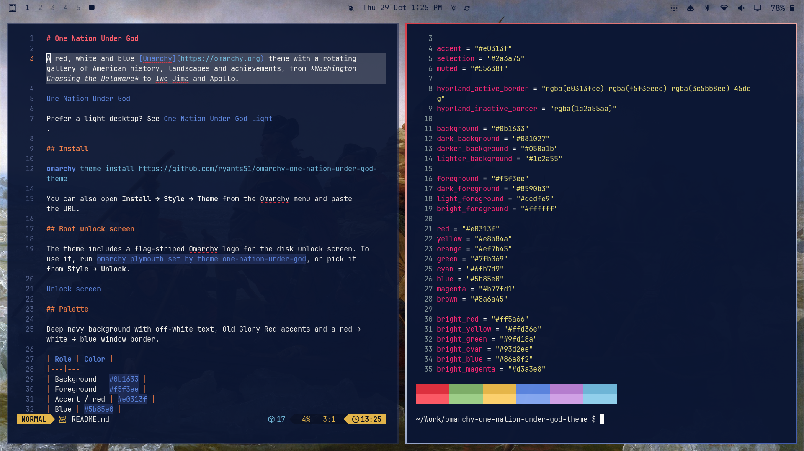

# One Nation Under God

A red, white and blue [Omarchy](https://omarchy.org) theme with a rotating gallery of American history, landscapes and achievements, from *Washington Crossing the Delaware* to Iwo Jima and Apollo.



Prefer a light desktop? See [One Nation Under God Light](https://github.com/ryants51/omarchy-one-nation-under-god-light-theme).

## Install

```bash
omarchy theme install https://github.com/ryants51/omarchy-one-nation-under-god-theme
```

You can also open **Install → Style → Theme** from the Omarchy menu and paste the URL.

## Boot unlock screen

The theme includes a flag-striped Omarchy logo for the disk unlock screen. To use it, run `omarchy plymouth set by theme one-nation-under-god`, or pick it from **Style → Unlock**.


## Palette

Deep navy background with off-white text, Old Glory Red accents and a red → white → blue window border.

| Role | Color |
|---|---|
| Background | `#0b1633` |
| Foreground | `#f5f3ee` |
| Accent / red | `#e0313f` |
| Blue | `#5b85e0` |
| Gold | `#e8b84a` |

## Backgrounds

All backgrounds are 2560×1440. Paintings that aren't 16:9 are cropped to fill the screen, and tall ones sit over a blurred backdrop.

- **Founding & early republic:** Washington Crossing the Delaware, the Declaration, the Constitution, the Prayer at Valley Forge, Washington and Lafayette at Valley Forge, Yorktown, Washington resigning his commission, USS *Constitution* vs *Guerriere*, the Battle of New Orleans
- **The Great Awakenings:** frontier camp meetings and revivals of the Second Great Awakening
- **Civil War:** Gettysburg (Thulstrup and the Philippoteaux Cyclorama), First Bull Run, the *Monitor* and *Merrimac*, Appomattox
- **Westward expansion & industry:** *American Progress*, *Westward the Course of Empire*, *The Lackawanna Valley*, *Forging the Shaft*, the Golden Spike, the Wright brothers' first flight
- **World War II:** Pearl Harbor, the Doolittle Raid, D-Day, MacArthur at Leyte, Iwo Jima
- **Space:** Friendship 7, Gemini 7, Earthrise, Apollo 11 and 15, Bruce McCandless's untethered spacewalk, and the Space Shuttle
- **The land:** Mount Rushmore, the National Mall, the Capitol, the Statue of Liberty, Yosemite, Yellowstone, the Tetons, Arches, the Smokies, Shenandoah, skylines, cornfields and coastlines
- **Armed forces:** USS *Missouri*, the Abrams tank, F-22, F-35C, the Blue Angels and Thunderbirds
- **Sport:** the 1980 USA–USSR hockey game

Step through them with `omarchy theme bg next`, or pick one from **Style → Background** in the Omarchy menu.

## Optional: random background at login and wake

Omarchy themes can't run code, so this is a separate opt-in. It picks a random background each time you log in and each time your machine wakes from sleep, and only while a One Nation Under God theme is active:

```bash
~/.config/omarchy/themes/one-nation-under-god/extras/background-shuffle/install.sh
```

If you use the light theme, run the same script from `one-nation-under-god-light` instead. To remove it, run `uninstall.sh` from the same folder.

## Credits

Every image comes from Wikimedia Commons. Paintings and U.S. government photos (military, NASA, National Park Service, National Archives, Library of Congress) are public domain. Others are under Creative Commons licenses. [CREDITS.md](CREDITS.md) lists the author, license and source for each image. If you reuse one, follow its license.

The theme files and scripts are MIT licensed (see [LICENSE](LICENSE)).
